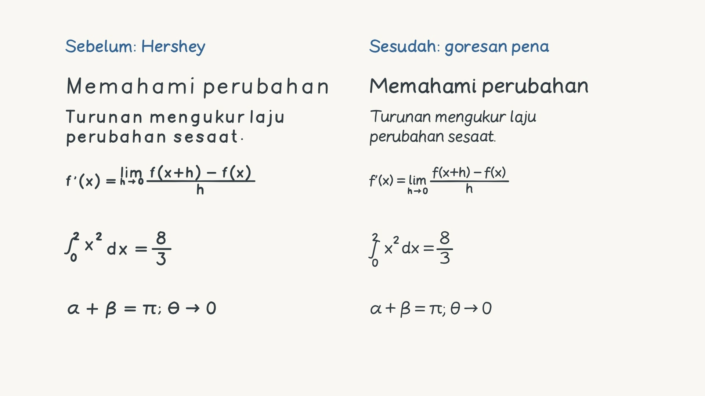

# Handwriting overhaul

## Audit

The old `src/handwriting/engine.ts` imported `src/lesson/hershey.json` for essentially all Latin letters and numbers. `src/lesson/paths.ts` maintained a second Hershey lettering route for the intro lesson and graph labels. These were native centerline draw shapes, but the drafting-font letterforms, repeated geometry, fixed proportions and uniform spacing still looked mechanically typeset. Baseline and slant variation was very small; the sinusoidal sample jitter changed the edge rather than the construction of the letter. The compiler already revealed arc-length point prefixes with minimum-jerk easing, but every stroke had the same proportional lift interval and no curvature-dependent speed. The three content roles shared the same pen profile. Math rows were centered using nominal heights instead of baselines; fractions assumed a fixed numerator height.

The renderer itself was not substituting text: it used tldraw DrawShapeUtil SVG exports. Changing export technology would not have fixed the letterforms. The retained pre-change engine and math layout are isolated comparison fixtures in `scripts/fixtures`; Hershey is no longer imported by production handwriting.

## Implementation

`src/handwriting/glyphs.ts` contains authored pen centerlines. Uppercase/lowercase Latin, digits and punctuation have deliberate start/end points and pen order. Single-storey a/g, open e crossbars, rounded shoulders, asymmetric bowls and descending g/j/p/q/y replace drafting-font forms. Each M command is a lift; Q/C commands describe the trajectory of the pen, not a glyph outline. Curves are sampled into pressure-bearing points before any native shape is created. Dots are short taps. No text shapes, font outline conversion, tracing, reveal masks or character-image overlays participate in handwriting.

The library includes integral, sum, root, arrows, comparisons, infinity, partial derivative, membership and Greek α β γ δ ε λ μ π ρ σ τ φ ω θ Δ Ω Σ. Ordinary Indonesian uses the full Latin alphabet. Curly quotes, prime and dash/minus variants have explicit aliases. Unsupported characters throw `Unsupported stroke glyph`; neither the compiler nor the intro lettering route substitutes ordinary text. Structured math handles multi-character exponents/subscripts; `^` remains a one-character exponent shorthand.

Seeded profiles distinguish headings (upright, wider, heavier), explanations (compact, lightly slanted), and mathematics (more stable spacing/baseline). Each letter gets small width/height/slant/spacing changes and a slowly correlated baseline drift. Seeded smooth curve-control deformation changes the bowl/shoulder shape without shaking sampled points. Arc-length pressure tapers at entry/exit and varies slightly between strokes. Variation is capped; it can be set to zero. Style can be specified explicitly with `handwritingStyle` on a write action.

The compiler creates a native tldraw `draw` shape per pen-down stroke, with `isPen: true`, pressure encoded in b64 point geometry and `isComplete: false` while writing. Absolute-time updates reveal growing ordered point prefixes at up to 60 Hz. Minimum-jerk entry/exit motion is retained, with additional time cost at turns, seeded stroke tempo and separate pen-lift gaps. Glyph, stroke and style metadata make this inspectable. Computed secant readouts also write progressively instead of appearing instantly. The intro author uses the same curve-aware timing and seeded profiles; the shipped 180-second media remains an archival original. Handwriting remains reproducible under seeking and different export frame schedules.

Math layout now carries explicit baselines. Equation rows align baselines; fraction bars align with the math axis and reserve the numerator's height; scripts reserve ascent/descent; integral/sum bounds and limits reserve their own extents. Radicals, fractions and symbols remain native pen geometry. This is a structured expression layout, not a TeX parser.

The flagship compilation rebuilds its aligned visual actions from the current authored lesson (including layout-derived algebra cancellation marks). Existing narration is reused only after checking spoken content and measured timing. Long chapter headings use a slightly smaller explicit heading profile to respect the existing safe width.

## Comparison and visual gate

[30-second comparison](../output/handwriting-comparison.mp4), 1920×1080, 30 FPS, 900 frames. Left: retained Hershey geometry/pressure; right: authored handwriting. Both use identical Indonesian content, equations, nominal heights, action start/end times and the native point-prefix renderer. The common handwritten labels identify the columns. The current animation scheduler is shared to isolate the visual differences in glyphs/styles/layout.

Content: “Memahami perubahan”, “Turunan mengukur laju perubahan sesaat.”, the derivative's limit/fraction definition, the definite integral of x² from 0 to 2 equaling 8/3, and “α + β = π; θ → 0”.

Ten renderer frames were inspected from 1.05 through 29.5 seconds. Decoded MP4 frames at 1.15, 15 and 29.5 seconds were also viewed before flagship regeneration. Early frames show the partial M trajectory; the middle frame shows limit construction; the final frame shows the complete matched content. The right-side prose visibly reads as compact hand printing, with curved, less uniform forms and natural spacing. Headings remain legible block handwriting; equations remain calm and readable. This is authored procedural handwriting, not a recording of an actual person's hand.



Native-record checks are separate from this visual judgment: `output/handwriting-validation.json` verifies that every comparison shape is a pressure-aware draw shape; completed glyph strokes have growing ordered prefixes matching their final geometry; all three styles are present; and decoded ink pixels increase within the first glyph. Such checks alone do not establish a convincing handwriting appearance.

## Reproduce

```sh
npm run handwriting:compare
npm run verify:handwriting
npm test
npm run build
npm run lesson:compile
npm run test:v2:browser
npx tsx scripts/verify-handwriting-intro.ts
npm run export:flagship -- --cache output/render-cache-handwriting-final
npm run verify:flagship
```

A different recording requires a new cache directory. The retained comparison fixtures intentionally remain unchanged when the production glyph library changes.

## Validation results

- Build and all 40 unit tests passed (34 handwriting/engine + 6 visual/asset/theme/MCP).
- The six flagship browser checks passed, including honest-generator records (pen/font/asset), theme events, record/pixel seeking equivalence, deterministic real-Editor compilation, and SVG export parity.
- The comparison verifier passed: 198 glyph strokes constructed progressively; first-glyph native points increased 3 → 30 → 83 at 1.05/1.15/1.30 seconds; decoded ink pixels increased 53 → 383 → 739.
- All eight regenerated chapter-end renderer frames were visually inspected for handwriting, equation placement and safe margins.

Additional decoded flagship chunk frames at 139.2 and 139.7 seconds show a partial “m” becoming the completed numeric secant readout. The decoded 232.896-second frame confirms that both cancellation marks cross the intended x² terms after rebuilding the aligned visual layout. These images are in `output/flagship-inspection/handwriting-detail/`.

The decoded 441.572-second integral frame was also visually reviewed at video resolution; the exponent, fraction bars, numeric bowls and spacing remained legible.

Final flagship media verification passed for both regenerated MP4s: 1920×1080 H.264, 30 FPS, 17,315 frames, 577.166667 seconds, Rec.709, and every frame timestamp equal to its index / 30. The narrated MP4 contains AAC and preserves the silent MP4’s video stream exactly. At 3.000/3.033/3.067/3.100 seconds, native points grew 2 → 28 → 37 → 69 and decoded ink pixels grew 29 → 233 → 330 → 552. Representative decoded chapter frames at 64.628, 185.196, 283.156 and 575.660 seconds were visually reviewed after the final export. Reports: `output/flagship-media-validation.json`, `output/v2-browser-validation.json`, `output/handwriting-validation.json`, and `output/handwriting-intro-validation.json`.

## Hybrid system (v4)

Stroke penmanship above remains the default for every role. Font mode adds
opt-in handwritten webfonts for expressive labels:

- Roles: `title`, `heading`, `explanation`, `annotation`, `math`
  (`src/handwriting/styles.ts`). Annotations default to Caveat font mode; math
  defaults to stroke mode to preserve baseline-accurate layout.
- Families: Patrick Hand, Kalam, Caveat, vendored offline in `public/fonts/`
  (SIL OFL 1.1, see `OFL-*.txt`) and mapped to tldraw text-shape fonts.
- Font mode renders native tldraw `text` shapes with deterministic seeded
  per-character reveal (`src/handwriting/font-mode.ts`). Shapes carry
  `generator: 'font-v1'`, `mode: 'font'`; nothing in font mode may claim pen
  construction. Structured math expressions are rejected in font mode with an
  error directing authors to stroke math.
- Stroke mode still throws `Unsupported stroke glyph` for unknown characters;
  the compiler never silently substitutes text for pen strokes.
- Offline export draws font-mode text directly on canvas with the vendored
  fonts (`src/engine/text-canvas.ts`), because tldraw text SVG uses
  `<foreignObject>`, which taints canvas rasterization. Live editing still uses
  the SDK renderer.

Set defaults per lesson (`handwriting: { role, font }`), per chapter
(`setHandwriting`), or per action (`handwritingStyle`, `handwritingFont`).
`set_handwriting_style` (MCP) edits either level and returns the honest label.
See `docs/VISUAL_ASSETS.md`, `docs/CANVAS_THEMES.md`, and `docs/MCP_TOOLS.md`
for the companion systems, and `output/visual-poc-validation.json` for the
60-second proof-of-concept that exercises both modes with portraits, math, and
animated diagrams before flagship regeneration.
